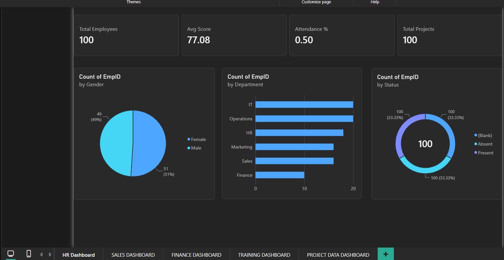
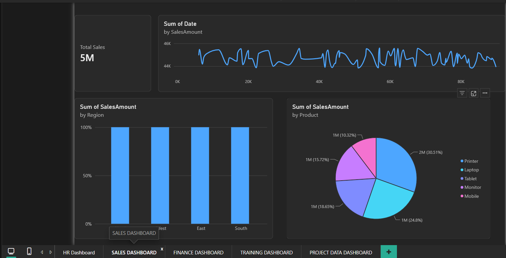
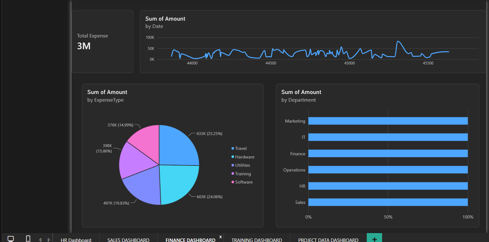
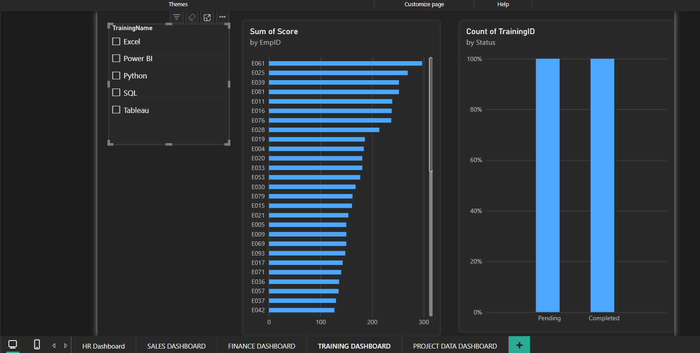
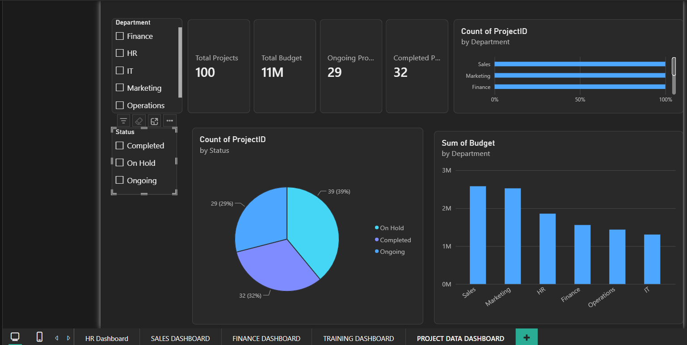

# ERP Business Intelligence Dashboard

## 📊 Project Overview

The **ERP Business Intelligence Dashboard** is an interactive Power BI project designed to analyze and visualize business data across multiple departments. It provides insights into HR, Sales, Finance, Training, and Project Management through KPI cards, charts, and interactive visualizations.

The dashboard helps users monitor performance, understand trends, and support data-driven business decisions.

## 🎯 Objectives

- Monitor key business performance indicators (KPIs).
- Analyze employee and departmental data.
- Track sales performance across regions and products.
- Analyze financial expenses by department and expense type.
- Monitor employee training scores and completion status.
- Track project budgets, status, and departmental distribution.

## 🛠️ Tools & Technologies

- Microsoft Power BI
- Data Visualization
- Business Intelligence
- KPI Reporting
- Interactive Dashboard Design

## 📈 Dashboard Modules

### 1. HR Dashboard
Analyzes employee metrics, department distribution, gender distribution, attendance, and employee status.



### 2. Sales Dashboard
Visualizes sales performance by region and product, with overall sales metrics and trend analysis.



### 3. Finance Dashboard
Provides an overview of total expenses, expense categories, departmental expenses, and financial trends.



### 4. Training Dashboard
Displays employee training scores, training categories, and training completion status.



### 5. Project Dashboard
Tracks total projects, total budget, ongoing projects, completed projects, and project status by department.



## 💡 Key Features

- Interactive KPI cards and visual reports.
- Department-wise business analysis.
- Sales, finance, HR, and training insights.
- Project status and budget monitoring.
- Visual comparisons using bar charts, pie charts, and trend charts.
- Consolidated view of multiple business functions.

## 📂 Project Structure

```text
ERP-Business-Intelligence-Dashboard/
├── screenshots_/
│   ├── 01-hr-dashboard.png.png
│   ├── 02-sales-dashboard.png.png
│   ├── 03-finance-dashboard.png.png
│   ├── 04-training-dashboard.png.png
│   └── 05-project-dashboard.png.png
├── ERP_Business_Intelligence_Dashboard.pbix
└── README.md
```

## 🚀 How to View the Project

1. Open the screenshots in this repository to preview the dashboards.
2. Download the `.pbix` file from the repository.
3. Open it using Microsoft Power BI Desktop to explore the report and interact with its visuals.

## 📌 Project Outcome

This project demonstrates practical skills in Power BI dashboard development, data visualization, KPI monitoring, and business performance analysis across multiple departments.


- [GitHub Profile](https://github.com/TejashreeJadhav16)
- [Portfolio Website](https://tejashreejadhav16.github.io/Tejashree_jadhav_Portfolio/)
